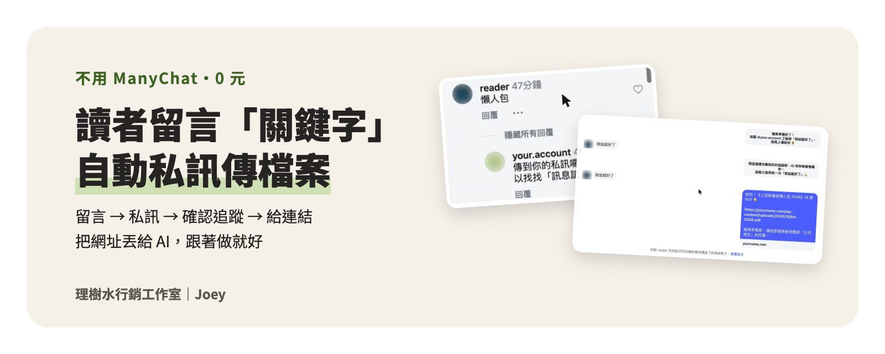

<p align="center">
  
</p>

<div align="center">

# IG 留言自動私訊小幫手

### 讀者留言「關鍵字」，幾秒內自動私訊傳檔案

**不用 ManyChat、0 元。把這份 Repo 丟給 AI，它會一步一步帶你架起來。**

</div>

> [!NOTE]
> 這是我在自己的 IG（@career.honesttree）實際架起來、用測試小號跑完整流程後，整理給同樣經營自媒體的人用的版本。
> 全程用 Meta 官方 API 和 Cloudflare 免費方案，只能用在**你自己的** IG 帳號。

---

## 做好之後長這樣

| 讀者留言「懶人包」 | 他收到的私訊 |
| :-- | :-- |
|  |  |
| 幾秒內，留言底下出現你的回覆 | 沒追蹤 → 請他追蹤；按「我追蹤好了」→ 收到檔案（手機上會有兩顆按鈕） |

- **可以關掉「要追蹤」這一關**：讀者一留言，就直接拿到檔案。
- **可以同時開好幾個活動**：留「懶人包」給 PDF、留「履歷」給模板，各給各的。
- **拿過的人再留言**：直接給連結，不會重問。

---

## 三種用法，挑一種

| 你用的是 | AI 會怎麼做 | 怎麼開始 |
| :-- | :-- | :-- |
| **ChatGPT、Gemini、Claude 網頁版或 App**（只能聊天） | **AI 帶你做**：一次教一步，每顆按鈕你自己按 | 打開 [`docs/給AI的說明.md`](./docs/給AI的說明.md)，整份複製，貼到新對話 |
| **Claude Code、Codex**（能用你電腦的終端機） | **AI 幫你做**：下載程式、部署、設定、測試都由它來；你只要登入、同意條款、按「發佈」這幾顆 | 把下面這句話貼給它 |
| **想裝成 Skill 重複用** | 之後說「新增一個留言關鍵字活動」就會叫出來 | 把 [`skills/ig-comment-dm-bot/`](./skills/ig-comment-dm-bot/) 整個資料夾放進 `~/.claude/skills/`（Codex 是 `~/.agents/skills/`） |

給 Claude Code、Codex 的那句話：

```text
讀 https://github.com/ChinYuanYang/ig-comment-dm-bot 的 AGENTS.md，帶我在自己的 IG 架留言關鍵字自動私訊。能幫我執行的步驟你直接做，需要我本人按的再告訴我。
```

> [!TIP]
> 「AI 幫你做」需要電腦裝有 Node.js。AI 會先幫你檢查，沒有的話會教你到官網下載安裝（一直按「下一步」就好）；不想裝，就改用「AI 帶你做」，部署只是在 Cloudflare 網頁上複製貼上。

想自己照著做，不透過 AI：看 [`docs/網頁版架設指南.md`](./docs/網頁版架設指南.md)，每一步都有實際畫面截圖。

---

## Repo 裡有什麼

| 檔案 | 它是什麼 | 誰會用到 |
| :-- | :-- | :-- |
| [`docs/給AI的說明.md`](./docs/給AI的說明.md) | 教 AI 當你的家教，加上完整步驟指南，一次複製貼上 | ChatGPT、Gemini 使用者 |
| [`docs/網頁版架設指南.md`](./docs/網頁版架設指南.md) | 全程只用瀏覽器的 10 個步驟，附截圖、名詞小字典、常見問題、隱私權政策範本 | 所有人 |
| [`AGENTS.md`](./AGENTS.md) | 給 AI Agent 讀的工作說明 | Claude Code、Codex、Cursor |
| [`skills/ig-comment-dm-bot/`](./skills/ig-comment-dm-bot/) | Skill 本體：說明、兩種架設指南、程式範本、自我測試 | 想裝成 Skill 的人 |
| [`skills/ig-comment-dm-bot/scripts/worker/src/index.js`](./skills/ig-comment-dm-bot/scripts/worker/src/index.js) | 小幫手的程式，整份貼到 Cloudflare，不用改 | 所有人 |
| [`CHANGELOG.md`](./CHANGELOG.md) | 每一版改了什麼 | 想知道有沒有更新的人 |

---

## 開始前，準備這 4 樣

- [ ] IG 是**專業帳號**（商業或創作者），而且是**公開**的
- [ ] 要送的檔案已經有**下載連結**（例如 Google 雲端硬碟設成「知道連結的人都能檢視」）
- [ ] 一個**測試小號**，最好有兩個：一個有追蹤你、一個沒有
- [ ] 大約 **1～2 小時**，加上一台電腦

> [!CAUTION]
> **一定要知道的 3 件事**
> 1. **鑰匙不要給任何人，包括 AI。** 權杖、密鑰、FB 密碼只貼進 Cloudflare 的設定欄位。不小心貼進對話了，就回 Meta 後台重新產生一把。
> 2. **「要追蹤才給」有風險。** Meta 社群守則不允許「要求追蹤才能拿到內容」，開不開這一關請自己決定。[Meta 社群守則：垃圾訊息](https://transparency.meta.com/zh-tw/policies/community-standards/spam/)
> 3. **先用小號測，再打開給大家。** 小幫手一開始只會回你的測試小號，測完沒問題再打開總開關。

---

## 常見問題

<details>
<summary>真的完全免費嗎？</summary>

Meta 開發者帳號免費。Cloudflare 免費方案每天可以處理 10 萬次請求，一般帳號用不完。
</details>

<details>
<summary>做完了，但讀者的留言都沒反應？</summary>

最常見的原因是 Meta App 還沒按「發佈」。沒發佈的時候，小幫手只看得到你自己，看不到讀者，而且不會出現任何錯誤訊息。
</details>

<details>
<summary>可以幫別人的帳號做嗎？</summary>

不行。這個做法只能用在你自己的帳號。幫別人的帳號做，要經過 Meta 審核和公司驗證。
</details>

更多問題看 [`docs/網頁版架設指南.md`](./docs/網頁版架設指南.md) 最後的「常見問題」。

---

## 卡住了怎麼辦

- **先問你的 AI**：把畫面截圖、錯誤訊息，還有你做到第幾步，一起交給它。
- **步驟跟畫面對不上、程式出錯**：開一個 [Issue](https://github.com/ChinYuanYang/ig-comment-dm-bot/issues) 告訴我，附上第幾步和你看到的畫面。
- 貼截圖或錯誤訊息之前，先確認裡面沒有權杖、密鑰和你的信箱。

---

## 關於

由 **Joey**（理樹水行銷工作室）整理。我在經營 IG [@career.honesttree](https://www.instagram.com/career.honesttree/)，也在 [growwatertree.com](https://growwatertree.com/) 寫職場和理財的文章。

Meta 和 Cloudflare 的後台按鈕之後可能會改名，找不到時把畫面截圖給 AI 看，照意思找就好。

程式碼以 [MIT 授權](./LICENSE) 釋出，可以自由使用與修改。
