# IG 留言自動私訊：網頁版架設指南（不用終端機）

> 給用 ChatGPT、Gemini，或不想碰終端機的人。全程只用瀏覽器，費用 0 元（Meta 開發者、Cloudflare Workers 免費方案）。
> 搭配檔案：`worker.js`（程式，整份複製貼上，不用改）。
> 後台按鈕名稱可能會改，找不到時照意思找，不要卡在原字。

## 名詞小字典（先看這裡）

| 你會看到的字 | 白話是什麼 |
|---|---|
| Meta App | 你跟 Meta 申請的「小幫手工作證」，有了它才能讀留言、傳私訊 |
| 權杖（Token） | 一把鑰匙，讓小幫手可以進你的 IG 做事。**只能放進 Cloudflare，不能給任何人** |
| 密鑰（Secret） | 另一種鑰匙，用來確認敲門的真的是 Meta |
| Cloudflare Worker | 一台免費、24 小時幫你值班的小電腦，程式放在這裡 |
| KV | 小電腦裡的筆記本，記住「傳過誰了」 |
| Webhook | 門鈴。有人留言或私訊，Meta 就按門鈴叫小幫手 |
| Cron（排程） | 鬧鐘。每分鐘響一次，小幫手就去看有沒有漏掉的留言 |
| 測試小號 | 你另外一個 IG 帳號，假裝成讀者來測試 |

## 做出來的效果

```
讀者留言「關鍵字」 → 幾秒內：私訊＋留言底下公開回覆
   ├─ 追蹤門檻關 → 私訊直接附檔案連結
   └─ 追蹤門檻開 → 私訊「回我一句關鍵字」→ 讀者回覆 → 查追蹤
          ├─ 有追蹤 → 傳連結
          └─ 沒追蹤 → [去追蹤] [我追蹤好了] 兩顆按鈕 → 追蹤後按 → 傳連結
```

可以同時跑好幾組關鍵字，各自對應不同檔案。


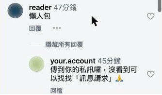
*讀者留言「懶人包」，幾秒內留言底下就出現你的回覆*


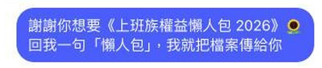
*同時收到私訊：請他回一句話*


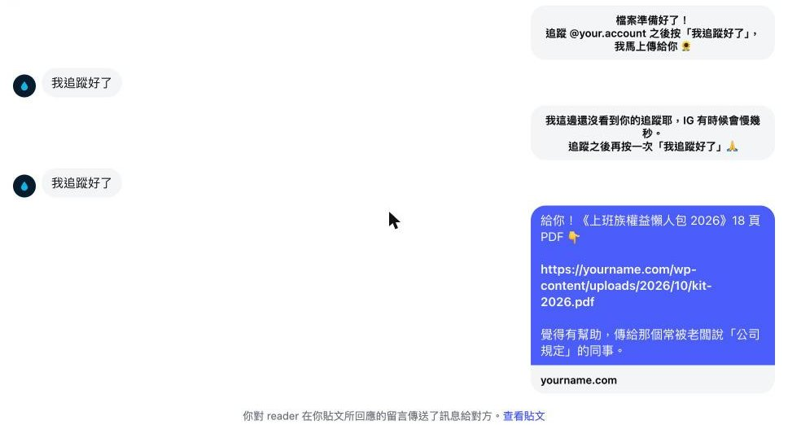
*沒追蹤 → 先請他追蹤；按「我追蹤好了」→ 查到有追蹤 → 傳檔案（電腦版看不到按鈕，手機上會有兩顆按鈕）*

## 開始前準備

- IG 是**專業帳號**（商業或創作者），而且**公開**。
- 要送的檔案已經有**下載連結**（自己網站、Google Drive「知道連結的人都能檢視」）。
- 一個**測試小號**，最好一個有追蹤你、一個沒追蹤。
- 一頁**隱私權政策**（本檔最後有範本，可放 Notion 公開頁或 Google 協作平台）。

## ⚠️ 追蹤門檻先想清楚

Meta 社群守則「垃圾訊息」不允許要求用戶互動（包含追蹤）才能取得特定內容。打開追蹤門檻有讓帳號被限制的風險，自己決定。
https://transparency.meta.com/zh-tw/policies/community-standards/spam/

---

## 第 1 步：Meta 開發者帳號

1. 用**個人 FB 帳號**登入 https://developers.facebook.com （FB 正在用粉專身分時，先切回個人帳號）。
2. 右上「立即開始」→ 驗證手機或 Email → 同意條款。

## 第 2 步：建 App

1. https://developers.facebook.com/apps/ →「建立應用程式」。
2. 名稱用英文，例如 `MyBrand Kit Bot`（不要含 Instagram、IG）。
3. 使用案例：篩選「全部」→ 勾「**管理 Instagram 的訊息和內容**」。
4. 商家：選「**我還不想連結商家資產管理組合**」（實測連結商家會建立失敗）。
5. 總覽頁最下面按「建立應用程式」。


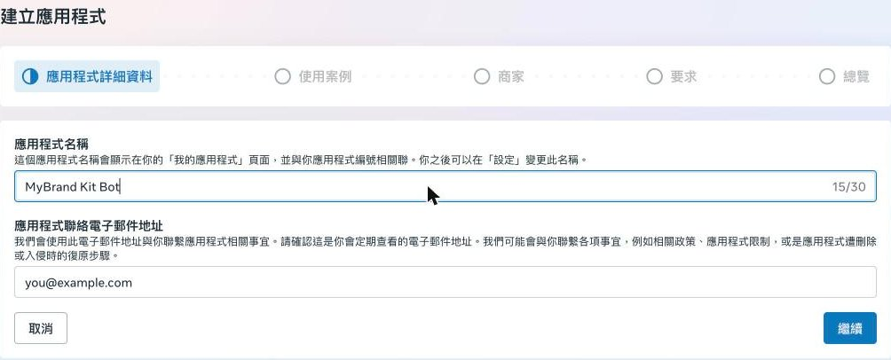
*名稱用英文*


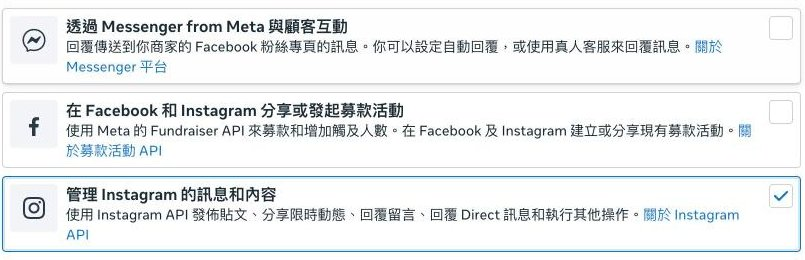
*勾「管理 Instagram 的訊息和內容」*


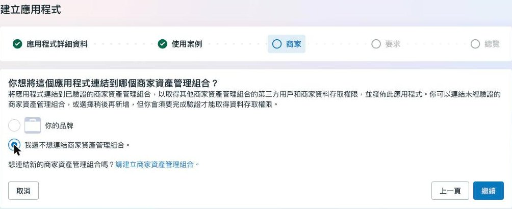
*選「我還不想連結商家資產管理組合」*

## 第 3 步：權限、測試人員、權杖

1. 左側「使用案例」→「自訂」→「含有 Instagram 登入的 API 設定」。
2. 第 1 步按「Add all required permissions」。
3. 左側「應用程式角色」→「角色」→「新增用戶」→「Instagram 測試人員」→ 輸入**你自己的 IG 帳號** →「新增」。
4. 到 IG 網頁 https://www.instagram.com/accounts/manage_access/ →「測試員邀請」→「接受」。
5. 回 API 設定第 2 步「新增帳號」→ 會跳出 IG 授權**小視窗**（常躲在其他視窗後面）→ 登入、允許。
6. 帳號那一列按「產生權杖」→ 勾「我瞭解」→「複製」。**權杖只貼到第 6 步的 Cloudflare，不要貼給任何人或 AI。**


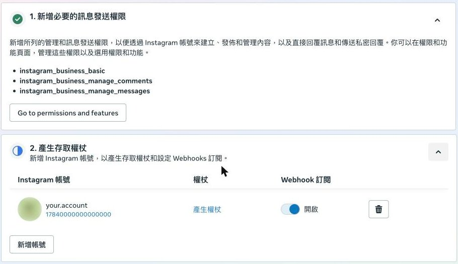
*第 1 步加權限、第 2 步新增帳號後按「產生權杖」*


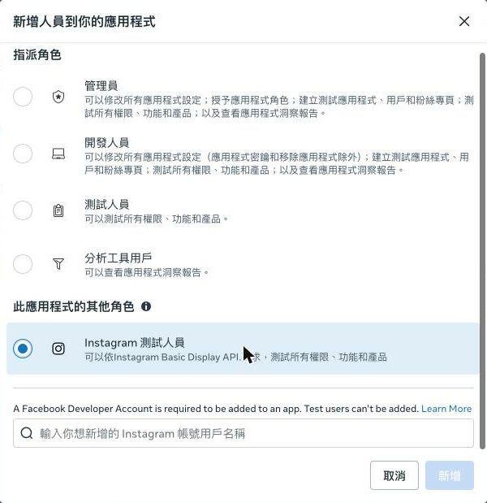
*新增「Instagram 測試人員」*

## 第 4 步：隱私權政策＋發佈 App（最重要）

**沒發佈前，App 只看得到你自己：讀者的留言、私訊全部讀不到，而且不會報錯。** 發佈不用商家驗證、不用送審。

1. 把隱私權政策頁公開，複製網址。
2. 左側「應用程式設定」→「基本資料」：「隱私政策網址」「資料刪除指示網址」都貼這個網址、「類別」選 Messenger Bots for Business →「Save Changes」。
3. 左側「發佈」→ 右下「發佈」。


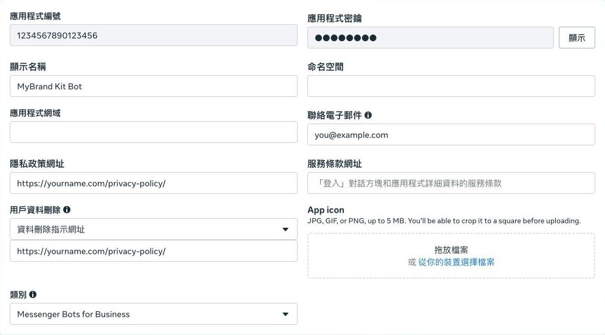
*填隱私政策網址、資料刪除網址、類別*


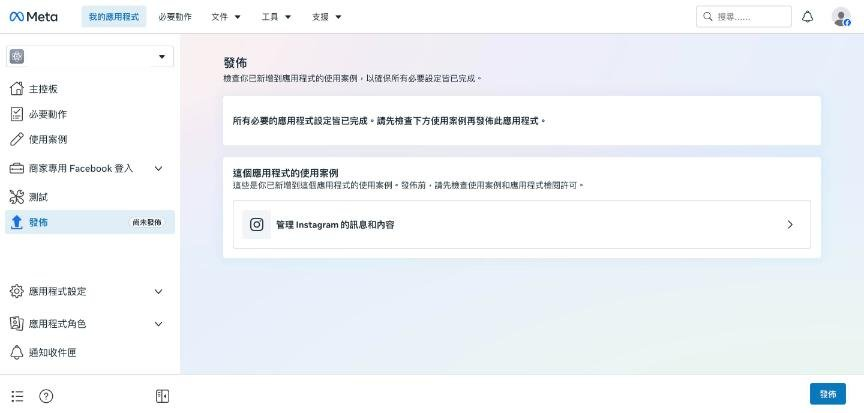
*右下角「發佈」*

## 第 5 步：Cloudflare 放程式

1. 免費註冊 https://dash.cloudflare.com/sign-up 。
2. 左側「Workers & Pages」→「Create」→ 選 Hello World 範本 → 取名（例如 `my-kit-bot`）→「Deploy」。
3. 按「Edit code」→ 把 `worker.js` **整份**貼上蓋掉原本的內容 →「Deploy」。
4. 記下網址：`https://my-kit-bot.<你的子網域>.workers.dev`。


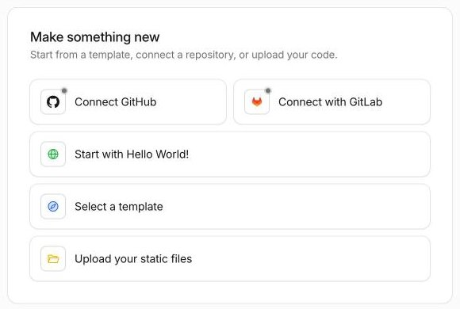
*選「Start with Hello World!」*


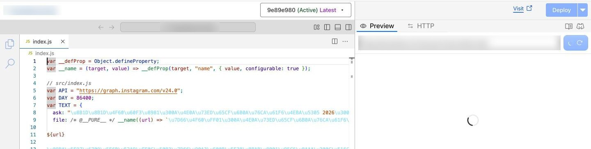
*Edit code：整份貼上，按右上「Deploy」*

## 第 6 步：資料庫、設定、排程

1. 左側「Storage & Databases」→「KV」→「Create」，名稱 `kit-bot-kv`。
2. 回到 Worker →「Settings」（或「Bindings」）→ 新增 **KV namespace** 綁定：變數名稱一定要叫 `KV`，選剛剛的 `kit-bot-kv`。
3. 「Settings」→「Variables and Secrets」，逐一新增：

| 名稱 | 類型 | 填什麼 |
|---|---|---|
| `IG_TOKEN` | Secret | 第 3 步複製的權杖 |
| `RUN_KEY` | Secret | 自己亂打一串 20 字以上的英數字（像密碼），等等開設定頁用 |
| `APP_SECRET` | Secret | Meta「基本資料」頁的「應用程式密鑰」（按顯示，要輸入 FB 密碼） |
| `IG_APP_SECRET` | Secret | API 設定頁的「Instagram 應用程式密鑰」 |
| `IG_USER_ID` | Text | 先填 `0`，第 7 步會告訴你正確值 |
| `IG_USERNAME` | Text | 你的 IG 帳號，不含 @ |
| `ENABLED` | Text | `false`（測完才改 `true`） |
| `TEST_USERS` | Text | 先空著，第 7 步會告訴你 |
| `FOLLOW_GATE` | Text | `true`＝追蹤才給；`false`＝留言就給 |
| `WATCH_POSTS` | Text | `3` |
| `REFRESH_CRON` | Text | `0 3 1 * *` |
| `HUB_VERIFY` | Text | 自己取一個英文字，例如 `kitbot-hello` |
| `CAMPAIGNS` | Text | 見下方 |

`CAMPAIGNS` 範例（一組或多組都可以，雙引號、逗號都要照抄）：

```json
[
  {"keyword": "懶人包", "name": "《上班族權益懶人包》", "file_url": "https://你的網站/檔案.pdf"},
  {"keyword": "履歷", "name": "《履歷模板》", "file_url": "https://docs.google.com/..."}
]
```

4. 「Settings」→「Triggers」→「Cron Triggers」新增兩個：`* * * * *`（每分鐘補掃）、`0 3 1 * *`（每月換權杖）。
5. 存檔或 Deploy，讓設定生效。


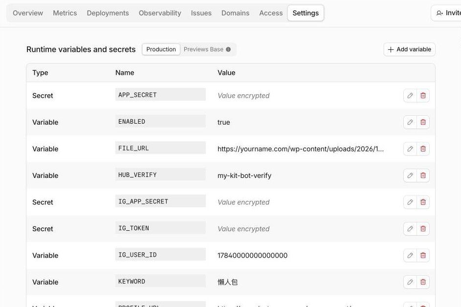
*Settings → Variables and Secrets*


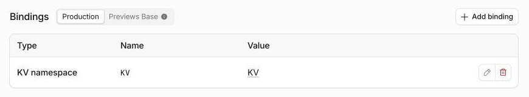
*Bindings：KV 的名稱一定叫 KV*


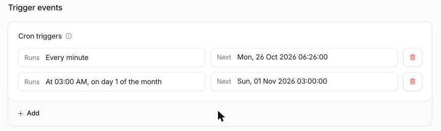
*Trigger events → Cron triggers 兩個*

## 第 7 步：一鍵設定頁

1. 先用**測試小號**私訊你的帳號一句話（例如「哈囉」）。
2. 瀏覽器打開：`https://my-kit-bot.<子網域>.workers.dev/setup?key=<你的 RUN_KEY>`
3. 頁面會顯示：
   - `IG_USER_ID 請填：…` → 回第 6 步把 `IG_USER_ID` 改成這個數字
   - `訂閱私訊通知：成功`
   - 最近私訊過的人 → 把**測試小號**後面的數字填進 `TEST_USERS`
4. 存檔讓設定生效。

## 第 8 步：讓 Meta 把通知送到程式

1. Meta 後台 API 設定第 3 步「設定 Webhooks」：
   - 回呼網址：`https://my-kit-bot.<子網域>.workers.dev/webhook`
   - 驗證權杖：填 `HUB_VERIFY` 的值（瀏覽器常自動填進 Email，先刪掉）
   - 「驗證並儲存」
2. 確認 `comments`、`messages`、`messaging_postbacks` 都是「已訂閱」。
3. ⚠️ 一定要在這個後台頁面設；別的方式設定可能顯示成功但收不到通知。


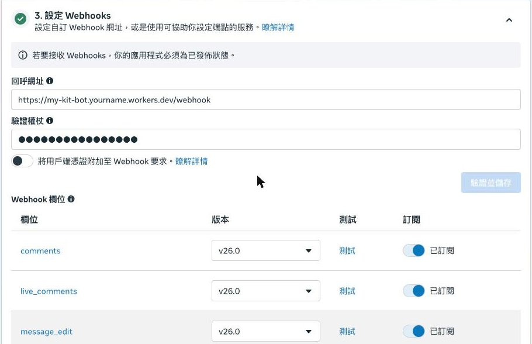
*回呼網址＋驗證權杖 → 驗證並儲存；comments、messages、messaging_postbacks 要是「已訂閱」*

## 第 9 步：用小號測（總開關還關著，只會回小號）

1. 小號在你**最新 3 篇**任一篇留言關鍵字 → 幾秒內收到私訊＋留言底下公開回覆。
2. 追蹤門檻開時：回一句 → 沒追蹤的小號收到兩顆按鈕 → 先按「我追蹤好了」→ 收到「還沒看到」→ 追蹤後再按 → 收到連結。
3. 沒反應時：打開 `https://…workers.dev/run?key=<RUN_KEY>` 手動跑一次，看它顯示什麼；Cloudflare Worker 的「Logs」也看得到每一步。

## 第 10 步：上線

`ENABLED` 改成 `true` → 存檔。之後讀者留言，幾秒內自動回。

## 第 11 步（選配，建議做）：出問題寄信給你

小幫手停掉的時候（例如 Meta 要你重新確認帳號、Cloudflare 免費額度用完），讀者會默默收不到私訊，你也不會知道。做完這一步，出事就會寄信給你。

1. 用你想收信的 Google 帳號打開 https://script.new 。
2. 把「寄信小程式」整份貼上（教學頁有複製按鈕；GitHub 上在 `skills/ig-comment-dm-bot/references/alert-mailer.gs`；用 AI 帶的話，它手上的說明最後面也有一份），蓋掉原本的內容，把 `you@example.com` 換成你的信箱，按存檔。
3. 右上「部署」→「新增部署作業」→ 齒輪選「網頁應用程式」→ 執行身分「我」、誰可以存取「所有人」→「部署」。
4. 按「授予存取權」→ 選你的帳號。看到「Google 尚未驗證這個應用程式」是正常的（程式是你自己的）：按「進階」→「前往（不安全）」→「允許」。
5. 複製「網頁應用程式網址」→ 到 Cloudflare 的「Variables and Secrets」新增 Secret：名稱 `ALERT_URL`，值貼上這個網址 → 存檔。
6. 瀏覽器打開 `https://…workers.dev/alert-test?key=<你的 RUN_KEY>`，信箱收到「測試信：通知功能正常」就完成了（沒收到先看垃圾郵件）。

---

## 常見問題

- **讀不到讀者留言**：App 還沒「發佈」（第 4 步）。
- **傳訊息出現「這則訊息並未在允許的期間內傳送」**：讀者的回覆早於第 7 步的訂閱，請他再回一次就好。
- **剛改了排程，留言沒被補到**：Cloudflare 改排程要幾分鐘才生效，用 `/run` 手動補跑。
- **讀者沒收到**：私訊可能在「訊息請求」；回覆別人留言的第二層留言不會觸發；超過 7 天的留言官方不允許私訊。
- **權杖過期**：程式每月 1 號自動換新（60 天有效）。如果 Worker 停了超過 60 天，要回第 3 步重新產生，再更新 `IG_TOKEN`。
- **小幫手停了一段時間，想補回漏掉的人**：打開 `https://…workers.dev/run?key=<RUN_KEY>&minutes=<往回看幾分鐘>&delay=6000&limit=8`，每次慢慢補 8 個人，回傳「no new comments」就補完了。留言後 7 天內都補得到。
- **為什麼要慢慢補**：一口氣發太多私訊和留言回覆，可能被 Meta 當成異常活動，鎖住開發者帳號（實際發生過）。
- **暫停**：`ENABLED` 改 `false`。
- **新增活動**：在 `CAMPAIGNS` 多加一組，存檔，用小號測新關鍵字。

## 隱私權政策範本（〈〉換成你的資料）

```
最後更新：YYYY 年 M 月 D 日

這份說明適用於〈品牌名〉（Instagram @帳號）的 IG 私訊小幫手。當你在〈品牌名〉的貼文留言索取檔案時，小幫手會用私訊把檔案連結傳給你。

我們會用到哪些資料：你的 Instagram 帳號編號與使用者名稱、你在〈品牌名〉貼文底下的留言、你傳給〈品牌名〉的私訊、你是否追蹤〈品牌名〉。

用在哪裡：只用來判斷你是不是在索取檔案，並把檔案連結私訊給你。不會拿來投放廣告，也不會賣給或分享給任何第三方。

保存多久：只保留「已經傳過檔案給誰」的紀錄（帳號編號與時間），避免重複傳送，最多保存 90 天後刪除。

想刪除資料或有問題：寫信到〈信箱〉，註明你的 Instagram 帳號，我們會在 7 天內刪除與你有關的紀錄並回覆你。
```
